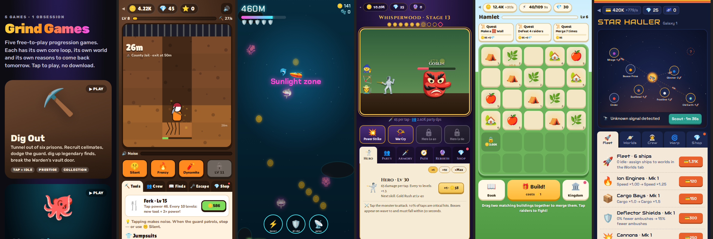
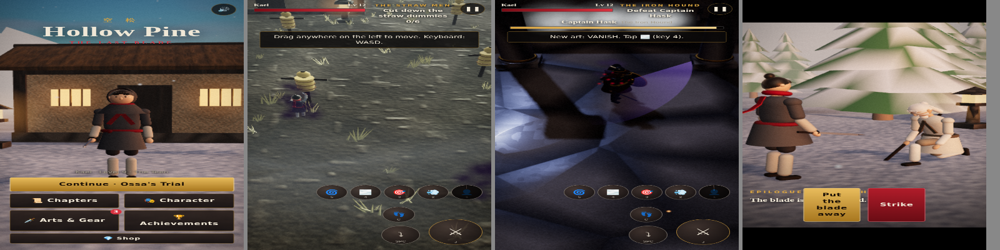

# Grind Games

**▶ Play now: https://planetmarz-creator.github.io/grind-games/**

**Six free-to-play games, each with its own core loop, world and look: five progression games and a 3D assassin action RPG.**

 They're plain HTML/JS with no build step, and they run in any browser.

| Game | Core loop | Progression | Enemies & bosses | Friends | Discoveries | Prestige |
|---|---|---|---|---|---|---|
| [**Dig Out**](digout/) ⛏️ | Tap to dig out of prison; crew digs while idle | 10 tool tiers, 10 crew, 4 abilities, player levels | The guard hears noise; a Warden vault door with a 30s timer | 10 cellmates, from Rat Pal to a Pocket Black Hole | 18 buried finds, each a permanent bonus | Escape → Freedom Stars, 6 prisons plus endless loops |
| [**Abyss Diver**](abyssdiver/) 🐙 | 30–90s dive runs: steer, loot, surface | 8 sub upgrades, 3 dive abilities | 12 sea creatures, 4 zone-gate bosses (Kraken, Megalodon…) | 5 ocean friends rescued at set depths, trained with pearls | Bestiary + 10 relics | Deeper zones; records |
| [**Slime Slayer**](slimeslayer/) ⚔️ | Tap to attack; party attacks while idle | Hero levels, 10 party members, 4 skills | 7 lands, 35 monsters, a boss every 10 stages | 10 allies who join as you advance | 15 gear pieces across 5 rarities | Rebirth → Soul Shards, plus a Paladin, Ranger or Sorcerer path |
| [**Merge Kingdom**](mergekingdom/) 🏰 | Drag to merge; Build! costs energy | 3 chains × 10 tiers, land expansion, quests | 6 raider types in timed raids | 6 advisors, including Merlin, who merges for you | Discovery book of 30 buildings | Wonders (merge two Lv 10s) |
| [**Hollow Pine**](hollowpine/) 🗡️ | Story chapters: sneak, take down, fight, dodge | Grow from boy → teen → young man → man; player levels with skill points, 6 disciplines, gear | 10 enemy types with vision cones; 5 bosses (Doran, Grel, Ossa, Hask, Varek) with telegraphed moves | Your father, your mother, a blind master | 5 assassin arts, earned cosmetics, 30 claimable achievements | Two endings, then The Ashes: endless waves |
| [**Star Hauler**](starhauler/) 🚀 | Ships run trade routes on a live star map | Fleet, 4 ship systems, crew levels | Pirate ambushes (tap dogfights), 2 blockade bosses | 5 crew recruited on new worlds | 12 worlds with lore | Warp → Dark Matter, richer galaxies |

## Hollow Pine



A 3D action RPG built on the short story in [`hollowpine/data.js`](hollowpine/data.js): a boy grows up in a hidden village of assassins, loses it on the Night of Red Snow, trains with a blind master, and climbs the regent's tower for vengeance, then has to choose what strength means.

- **14 chapters across 4 acts + an epilogue choice.** The hero visibly ages between acts (boy, teen, young man, man).
- **Stealth:** vision cones fill yellow then red; sneak, hide behind houses, and take down unaware enemies instantly.
- **Combat:** 3-hit combos, dodge rolls with invulnerability frames, and five arts: Shadow Step, Smoke Bomb, Poison Dart, Vanish, Blade Storm.
- **Bosses** telegraph every attack on the ground in red: sweeps, lunges, charges into pillars, slams, poison pools, blood rain.
- **Character creator:** skin, hair, colour, eyes, 10 outfits, masks (hood, oni, fox, blindfold), scarves, 6 blades, scars, beards. Premium looks cost silver or jade; some are earned only through the story.
- **Progression:** XP levels with skill points, rankable arts, gear upgrades, 3 stars per chapter, 30 achievements you claim for silver and jade, daily streak, endless mode.
- **Ink & Steel style:** a depth-based ink-outline pass and a near-monochrome grade that keeps only blood-red and fire, brush-kanji act title cards (悲劇 Tragedy · 修行 Training · 復讐 Vengeance · 力 Strength), and ink-wipe transitions. You can switch to the plain color style from the pause menu.
- **Combat feel:** hit-stop, camera punch and FOV kick, blade trails, dodge afterimages, chromatic flashes, and a slow-motion kill cam on takedowns and boss kills. Phones vibrate on hits.
- **Parry and posture (Sekiro-style):** tap 🛡 as a blow lands to deflect it, or send arrows and knives back at their owner. Parries and hits fill an enemy's posture. When it breaks, ⚔ becomes a FINISHER.
- **Procedural soundtrack:** koto, shakuhachi-style flute, a drone and taiko, all synthesized with Web Audio. The music moves from exploration to combat to boss layers, and a heartbeat plays at low health. Every sword swing, clang and parry is synthesized too.
- **Controls:** drag the left side to move, buttons on the right; keyboard WASD, J strike, Space dodge, L parry, C sneak, 1–5 arts.

## Living worlds and extras

| Game | World | Extra features |
|---|---|---|
| Dig Out | Roots, worms, fossils, glowing mushrooms, sewer pipes, crystals and lava cracks by depth; bats and water drips | Buried chest blocks (8×), gold veins (4×), random 12s Gold Rush (3×) |
| Abyss Diver | Coral, anemones and kelp; shipwrecks and a passing whale; sunken columns and smoking vents with tube worms; whale skeletons; fish schools | Air bubble pickups (+5s O₂), sunken treasure chests (20×) |
| Slime Slayer | Per-land weather (pollen, leaves, wisps, embers, snow, clouds, motes), critters and a distant landmark | Rare Golden Slime, tap combo (up to +100%), boss loot chests with guaranteed gear |
| Merge Kingdom | Day/night with lit windows and fireflies, river with bridge and ducks, villagers, sheep, windmill, chimney smoke, cloud shadows, birds | **Next Build! preview in 3D**, next-discovery silhouette, merge-result holograms while dragging, coin bubbles, treasure chests, wandering merchant |
| Star Hauler | Asteroid belt, orbiting moons, NPC traffic, a wormhole, meteor streaks | Tap comets and salvage crates for credits and gems |

## What brings players back (in every game)

- **A satisfying core action** with instant feedback: sound, particles, shake, floating numbers.
- **Compounding growth**, with idle-game cost and power curves tuned by simulation (see *Balancing* below).
- **Something new around the corner:** new zones, enemies, friends, collectibles and abilities unlock at milestones.
- **Prestige loops** that reset progress for permanent multipliers, so every run goes further than the last.
- **Return hooks:** offline earnings, a 7-day daily streak and timers.
- **Achievements** that pay out gems.

## Monetisation

Every game shares one store model from `shared/engine.js`:

| Product | Price | What it does |
|---|---|---|
| Starter Pack | $2.99, one-time | 500 💎 + permanent 2× earnings |
| VIP Pass | $4.99, one-time | Offline cap 8h → 24h, 2× offline earnings, +50 💎 daily |
| Gem packs | $0.99 / $4.99 / $9.99 | 100 / 600 / 1,400 💎 |

Gems buy **specific, visible things**: time skips, 2× loot, energy refills, bribing a guard, skins, switching your Slime Slayer path. There are **no paid random loot boxes**. Apple and Google require published odds for those, several countries regulate them as gambling, and apps without them are easier to get featured.

**This web build is a demo:** the checkout confirms without charging. To take real money:
1. Wrap each game with **Capacitor** (keeps this HTML/JS as-is) to get iOS and Android apps.
2. Add **RevenueCat** (or StoreKit / Google Play Billing directly) and replace `Grind.checkout()` with a real purchase call. It's one function.
3. Add a small backend or RevenueCat entitlements to verify purchases, so `state.owned` can't be edited on the device.
4. Optional: rewarded video ads (AdMob) where gem sinks already exist, e.g. "2× loot" → "watch an ad for 2× loot".

## Balancing

Each game's economy was checked with a headless simulation of a player tapping and buying greedily. The first version of Dig Out's difficulty curve became impossible after prison 3; the sim caught it and the numbers were retuned. Current targets for an active player:

- **Dig Out:** prisons clear in about 1 / 2 / 4 / 13 / 54 / 95 minutes.
- **Slime Slayer:** stage 25 at about 15 min, first rebirth at about 35 min, stage 100 at about 2 h.

Real players who mix in idle and offline time take several times longer. That's intended.

## Structure

```
games/
├── index.html          # the collection hub
├── shared/engine.js    # saves, offline earnings, daily streaks, store, achievements, sound, modals (no styling)
├── shared/realism.js   # realistic rendering kit (lighting, post-processing, procedural PBR textures)
├── shared/vendor/      # Three.js + add-ons (bundled, minified) + license
└── <game>/index.html   # each game: its own design, content and loop
```

## Run

Serve the folder over HTTP: `npx serve .` or `python3 -m http.server`. Dig Out is 3D and loads its renderer as an ES module, which browsers block when you open files directly (`file://`). GitHub Pages and web game portals serve over HTTP, so they work as-is. Progress saves in `localStorage`.

## 3D

All six games render in realistic 3D with [Three.js](https://threejs.org) (MIT; bundled with its add-ons into `shared/vendor/three-kit.min.js`, about 244KB gzipped). `shared/realism.js` sets up physically based rendering: image-based lighting, ACES tone mapping, soft shadows, bloom, a subtle lens finish, adaptive resolution for slower phones, and procedural PBR textures (rock, dirt, metal, wood, stone, fabric, ice, roof tiles, planks…) generated in code instead of image files.

Game logic is unchanged: each game's `*3d.js` module only draws the state it's given, and the 2D view stays as a fallback until the 3D module loads.

| Game | 3D scene |
|---|---|
| Dig Out | Ant-farm cutaway of textured rock with ore and gem veins, lantern-lit digger, steel vault door, searchlight |
| Abyss Diver | Yellow sub, a procedural model for every creature, gold coins, relics, Kraken/Megalodon/Leviathan/Old One, canyon walls, light rays, darkening depths |
| Slime Slayer | Jelly-physics slime variants (moss, ghost, lava, obsidian, ice, void…), seven arenas, hero whose gear follows the chosen path, party |
| Merge Kingdom | Diorama board with a model for all 30 building levels plus Wonders, raiders, and a drag that lifts the building |
| Hollow Pine | Procedural jointed characters with pose-blended animation, a sky and image-based light per chapter, burning villages, waterfalls, rope bridges, rooftops, a throne room, snow, embers and fog |
| Star Hauler | Galaxy with a glowing star, 12 textured planets (clouds, rings, lava, crystal), ship flights, pirate flagship, nebulae |
